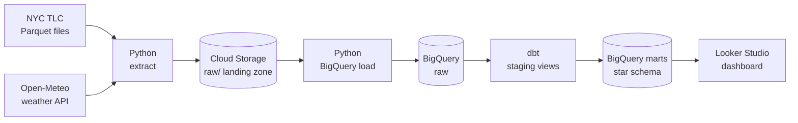
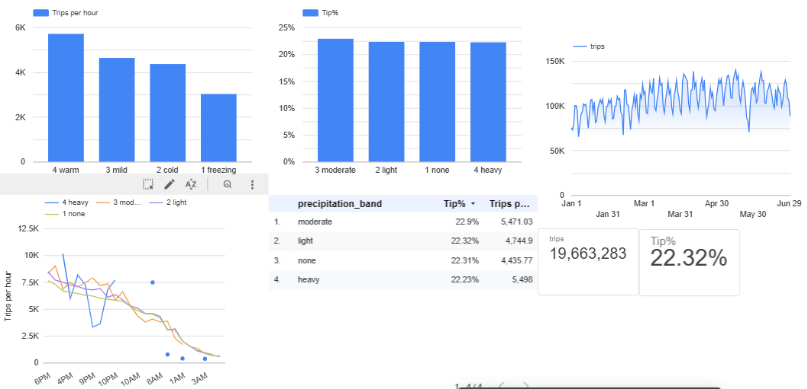
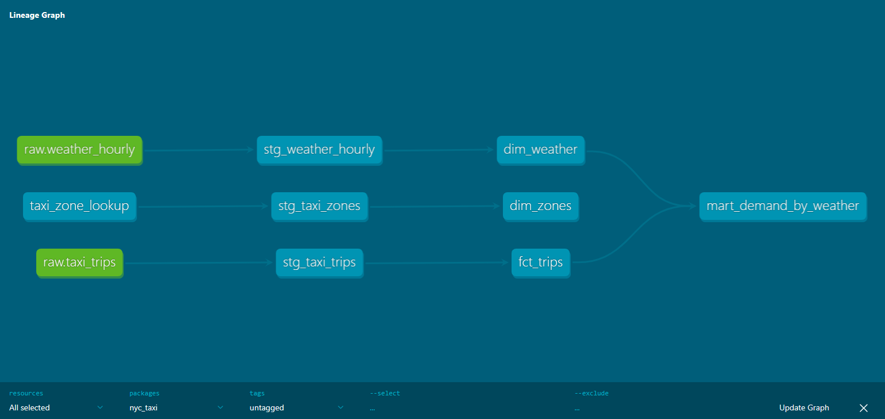

# NYC Taxi ELT Pipeline
<!-- 
[](https://github.com/gashndolo/nyc-taxi-elt/actions/workflows/ci.yml)
 -->
A batch ELT pipeline on Google Cloud that ingests NYC TLC taxi trip data and
Open-Meteo weather data, loads it into BigQuery, and transforms it into a
star schema with dbt. Airflow orchestrates the monthly run, and a Looker Studio
dashboard explores one question: **how do weather conditions affect taxi demand
and tipping behavior?**

**[View the live dashboard](https://datastudio.google.com/reporting/16f42996-541a-49af-aa91-0258e500fa2a)**

**Stack:** Python · Google Cloud Storage · BigQuery · dbt · Apache Airflow · Docker · Looker Studio · GitHub Actions

## Results at a glance

| | |
|---|---|
| Data loaded | **20.3M** taxi trips (Jan to Jun 2024) and **4,368** hourly weather observations |
| Data quality | **3.29%** of trips removed by validation rules and deduplication (19.66M kept) |
| Query cost | **~93% less data scanned** with partitioning and clustering (229.6 MB vs 15.7 MB) |
| Testing | **21 dbt data tests** across 7 models and 1 seed, all passing, plus Python unit tests in CI |
| Orchestration | Monthly Airflow DAG with upstream sensor, retries, failure alerts, and idempotent backfills |

## Architecture



The Airflow DAG runs once per month of data:


## Dashboard



### What the data shows

These are observations from six months of data, not causal claims.

- **Overall, wet hours were busier than dry ones**, but that comparison mixes in time of day and season, so it isn't a fair one.
- **Like for like (weekday, 5 to 7 pm):** the 56 hours with rain or snow averaged **8,322 trips per hour**, against **7,528** across 334 dry hours, about **11% higher**.
- **Tipping barely moved.** The card tip rate was 24.4% in both groups, and ranged only from 22.2% to 22.9% across precipitation bands.
- **Caveats:** only 56 wet hours in the like-for-like comparison, no significance test, and other factors (events, day of week, season) are not controlled for. Heavy precipitation has just 14 hours in this period, so no conclusions are drawn about it.

## Data sources

| Source | What | Grain | Access |
|---|---|---|---|
| [NYC TLC Trip Record Data](https://www.nyc.gov/site/tlc/about/tlc-trip-record-data.page) | Yellow taxi trips, monthly Parquet | One row per trip (~3M/month) | Public download |
| [Open-Meteo Historical Weather API](https://open-meteo.com/) | Temperature, precipitation, snow, wind, weather code | One row per hour | Free, no API key |
| TLC Taxi Zone Lookup | Zone ID to borough and neighborhood | 265 zones | Loaded as a dbt seed |

Weather is requested in `America/New_York` local time so it joins directly to TLC pickup timestamps, which are also local.

## Data model



| Layer | Model | Materialization | Purpose |
|---|---|---|---|
| Raw | `raw.taxi_trips`, `raw.weather_hourly` | Table (loaded by Python) | Source data under a fixed type contract |
| Staging | `stg_taxi_trips` | View | Rename, filter invalid trips, deduplicate, add derived fields |
| Staging | `stg_weather_hourly`, `stg_taxi_zones` | View | Rename and type columns |
| Marts | `dim_zones`, `dim_weather` | Table | Dimensions (weather adds readable condition, precipitation, and temperature bands) |
| Marts | `fct_trips` | Incremental table | One row per valid trip, partitioned by pickup date, clustered by pickup zone |
| Marts | `mart_demand_by_weather` | Table | One row per hour: weather alongside trips, fares, and tips |

| Table | Rows | Size |
|---|---|---|
| `raw.taxi_trips` | 20,331,944 | 4.8 GB |
| `marts.fct_trips` | 19,663,283 | 3.4 GB |
| `marts.mart_demand_by_weather` | 4,368 | 0.6 MB |

### Data quality rules (staging)

A trip is kept only if all of these hold:

- pickup time is before dropoff time
- trip lasted under 24 hours
- trip distance is greater than 0
- fare amount is greater than 0
- tip amount is not negative

TLC has no trip ID, so `trip_id` is a surrogate key hashed from the trip's identifying fields, and duplicates are removed by keeping the most recently loaded row.

Of 20,331,944 raw rows, **668,661 (3.29%)** were removed by these rules and deduplication. Rows with pickup dates outside the file's month are dropped earlier, at load time, and logged.

### Tests

`dbt build` runs **21 data tests**: uniqueness and not-null on keys, accepted values for payment types, accepted ranges for temperature and tips, and referential checks from the fact table to both dimensions. All pass with no warnings.

## Key design decisions

**Idempotent ingestion.** Every file lands at a deterministic path (`raw/taxi/year=2024/month=01/...`). If the object exists, the download is skipped. A `--force` flag overwrites. Rerunning any month leaves the bucket unchanged.

**Schema contract in the raw layer.** TLC's schema drifts between months (`passenger_count` changes type, `Airport_fee` changes capitalization, newer files add columns). Each month loads into a temporary staging table, then an explicit `SAFE_CAST` into the final table enforces one set of names and types. Missing columns become `NULL` and unexpected ones are logged and ignored.

**Atomic month replace.** The load deletes a month's rows and inserts the new ones inside a single BigQuery transaction, so reruns never duplicate data.

**Partitioning and clustering.** `raw.taxi_trips` is partitioned by pickup day and clustered by pickup and dropoff zone. Benchmark (one week, one pickup zone, query cache off, measured on Jan to Mar 2024):

| Table | Bytes billed |
|---|---|
| Unpartitioned copy | 229.6 MB |
| Partitioned and clustered | 15.7 MB |

That is a **~93% reduction** in scanned bytes, and on-demand pricing is per byte scanned. The gap grows with table size. See `scripts/partition_benchmark.py`.

**Incremental fact table.** `fct_trips` uses a `_loaded_at` watermark and the `insert_overwrite` strategy, so only newly loaded days are rebuilt. A change to model logic needs `--full-refresh`.

**Additive measures in the mart.** `mart_demand_by_weather` stores sums and counts instead of only averages, and the dashboard computes rates from them. Tip percentage is `sum(tips) / sum(fares)`, never an average of hourly percentages.

**Tips count card payments only.** TLC records tips only for credit card trips; cash tips appear as zero. Including cash trips would understate tipping and distort the weather comparison.

**Fair weather comparison.** Demand varies more by time of day than by weather, so the mart carries `hour_of_day` and `is_weekend`, and the headline comparison fixes both.

**Orchestration choices.**
- *Monthly data intervals:* each DAG run is responsible for one calendar month, which makes backfills a one-line command.
- *Upstream sensor:* TLC publishes with a lag of about two months, so the first task waits (in reschedule mode, freeing the worker) until the month's file exists.
- *One run at a time:* `max_active_runs=1` prevents two dbt builds writing to the same tables.
- *Retries and alerts:* each task retries twice, and a final failure triggers a callback that logs and optionally posts to a webhook.
- *Isolated environment:* pipeline code and dbt run from a separate virtualenv in the Airflow image, so their dependencies never conflict with Airflow's.
- *Lean local setup:* LocalExecutor with Postgres in Docker Compose, instead of Cloud Composer, to avoid ongoing cloud cost.

**Security.** The pipeline uses a least-privilege service account (Storage Object Admin, BigQuery Data Editor, BigQuery Job User). The key lives outside the repo and is mounted read-only into the containers, configuration comes from `.env` (git-ignored), and the dbt profile reads only environment variables.

## CI

GitHub Actions runs on every push and pull request:

- **Python job:** `ruff` lint, a compile check of the DAG file, and `pytest` unit tests covering path logic, the schema contract, month boundaries, and the idempotency skip.
- **dbt job:** `dbt deps` and `dbt parse`, which validate every model, ref, source, and YAML file without a warehouse connection or secrets.

CI does not run the models against BigQuery, so SQL errors that only the warehouse detects are caught locally by `dbt build` rather than in CI.

## Repository layout

```
nyc-taxi-elt/
├── .github/workflows/ci.yml   # lint, unit tests, dbt parse
├── airflow/
│   ├── Dockerfile             # Airflow image + isolated pipeline venv
│   └── dags/nyc_taxi_elt.py   # the monthly DAG
├── dbt_project/
│   ├── models/staging/        # cleaning layer
│   ├── models/marts/          # star schema + analysis mart
│   ├── macros/                # schema naming override
│   ├── seeds/                 # taxi zone lookup
│   ├── ci/profiles.yml        # placeholder profile for CI parsing
│   └── profiles.yml           # reads env vars, no secrets
├── ingestion/                 # Python: download, GCS upload, BigQuery load
├── scripts/                   # partitioning benchmark
├── tests/                     # unit tests
├── docs/                      # screenshots and diagrams
├── docker-compose.yml
├── .env.example
└── requirements.txt
```

## Getting started

**Prerequisites:** a GCP project with billing enabled (set a budget alert), `gcloud` CLI, Docker with Compose v2, Python 3.10+, Git.

**1. Cloud resources**

```bash
export PROJECT_ID=your-project-id
export REGION=us-central1

gcloud services enable bigquery.googleapis.com storage.googleapis.com
gcloud storage buckets create gs://${PROJECT_ID}-raw --location=${REGION} --uniform-bucket-level-access
bq --location=${REGION} mk --dataset ${PROJECT_ID}:raw

gcloud iam service-accounts create elt-pipeline
SA=elt-pipeline@${PROJECT_ID}.iam.gserviceaccount.com
for ROLE in roles/storage.objectAdmin roles/bigquery.dataEditor roles/bigquery.jobUser; do
  gcloud projects add-iam-policy-binding ${PROJECT_ID} --member="serviceAccount:${SA}" --role="${ROLE}"
done
gcloud iam service-accounts keys create ~/.gcp/elt-pipeline.json --iam-account=${SA}
```

Store the key outside the repository and never commit it.

**2. Local environment**

```bash
git clone https://github.com/gashndolo/nyc-taxi-elt.git
cd nyc-taxi-elt
python3 -m venv .venv && source .venv/bin/activate
pip install -r requirements.txt
cp .env.example .env     # fill in real values, plus the Airflow secrets below
```

Add to `.env`: `AIRFLOW_UID` (output of `id -u`), `AIRFLOW_FERNET_KEY`, and `AIRFLOW_JWT_SECRET` (see `.env.example`).

**3a. Run one month by hand**

```bash
python -m ingestion.run --year 2024 --month 1
```

Run it twice to see idempotency: the second run skips the download and replaces the month's rows with identical data.

**3b. Or run it with Airflow**

```bash
mkdir -p logs
docker compose build
docker compose up -d
```

Open http://localhost:8088, unpause `nyc_taxi_elt`, and backfill history:

```bash
docker compose exec airflow-scheduler airflow backfill create \
  --dag-id nyc_taxi_elt --from-date 2024-01-01 --to-date 2024-06-30
```


The Airflow UI has its login disabled for local development only. Never expose that port to a network.

**4. Transform with dbt by hand**

```bash
set -a; source .env; set +a
cd dbt_project
dbt deps
dbt build --profiles-dir .
dbt docs generate --profiles-dir .
dbt docs serve --port 8085 --no-browser --profiles-dir .
```

## Cost and performance

At this scale everything fits inside Google's free tiers (check current limits): BigQuery storage is about 8.2 GB across the raw and mart tables.

A full `dbt build` over six months of data processes about **11.3 GB** across 29 nodes (1 seed, 7 models, 21 tests). The tests and the deduplicating staging view read whole tables on each run, so this grows with history. Pushing the incremental filter earlier in the staging layer, or materializing staging as an incremental table, is the next optimization if the dataset keeps growing.

## Known simplifications

- Single environment: the schema-naming override means dev and prod would share the `staging` and `marts` datasets.
- Yellow taxis only; green taxi and for-hire vehicle data are not included.
- One weather point (central NYC) is applied to the whole city.
- CI validates code and dbt project structure but doesn't build against BigQuery. Doing so safely would need Workload Identity Federation rather than a stored key.
- Findings are observational, from six months of data, and not a statistical analysis.

## Roadmap

- [x] **Phase 1:** idempotent ingestion to Cloud Storage
- [x] **Phase 2:** BigQuery load with schema contract, partitioning, and clustering
- [x] **Phase 3:** dbt staging, star schema, incremental fact table, tests, docs
- [x] **Phase 4:** Airflow DAG with sensor, retries, alerts, and backfill
- [x] **Phase 5:** Looker Studio dashboard, unit tests, GitHub Actions CI
- [ ] Ideas: load more months, add green taxi data, run dbt builds in CI with Workload Identity Federation

## License and acknowledgements

Code is released under the MIT License. Trip data courtesy of the NYC Taxi and Limousine Commission. Weather data from [Open-Meteo](https://open-meteo.com/) (CC BY 4.0). Both datasets have their own terms of use.
