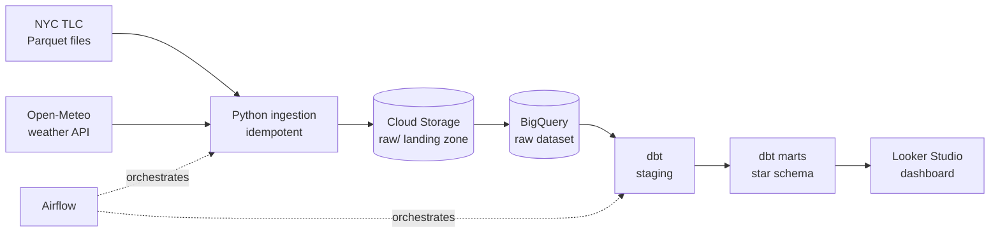

taxi_trips_flat    processed=   229.3 MB  bytes billed=   229.6 MB
taxi_trips         processed=    15.3 MB  bytes billed=    15.7 MB

# NYC Taxi ELT Pipeline

A batch ELT pipeline on Google Cloud that ingests NYC TLC taxi trip data and
Open-Meteo weather data, loads it into BigQuery, and transforms it into a
star schema with dbt. A Looker Studio dashboard will answer one question:
**how do weather conditions affect taxi demand and tipping behavior?**

**Stack:** Python · Google Cloud Storage · BigQuery · dbt · Docker · Apache Airflow · GitHub Actions

**Status:** in progress. Ingestion, loading, and transformation are complete. Orchestration, dashboard, and CI are next.

---

## Architecture



Dotted lines show orchestration, which is planned (see [Roadmap](#roadmap)).

## Data sources

| Source | What | Grain | Access |
|---|---|---|---|
| [NYC TLC Trip Record Data](https://www.nyc.gov/site/tlc/about/tlc-trip-record-data.page) | Yellow taxi trips, monthly Parquet | One row per trip (~3M/month) | Public download |
| [Open-Meteo Historical Weather API](https://open-meteo.com/) | Temperature, precipitation, snow, wind, weather code | One row per hour | Free, no API key |
| TLC Taxi Zone Lookup | Zone ID to borough and neighborhood | 265 zones | Loaded as a dbt seed |

Weather is requested in `America/New_York` local time so it joins directly to TLC pickup timestamps, which are also local.

## Data model


| Layer | Model | Materialization | Purpose |
|---|---|---|---|
| Raw | `raw.taxi_trips`, `raw.weather_hourly` | Table (loaded by Python) | Source data under a fixed type contract |
| Staging | `stg_taxi_trips` | View | Rename, filter invalid trips, deduplicate, add derived fields |
| Staging | `stg_weather_hourly`, `stg_taxi_zones` | View | Rename and type columns |
| Marts | `dim_zones`, `dim_weather` | Table | Dimensions (weather adds readable condition, precipitation, and temperature bands) |
| Marts | `fct_trips` | Incremental table | One row per valid trip, partitioned by pickup date, clustered by pickup zone |
| Marts | `mart_demand_by_weather` | Table | One row per hour: weather alongside trips, fares, and tips |

### Data quality rules (staging)

A trip is kept only if all of these hold:

- pickup time is before dropoff time
- trip lasted under 24 hours
- trip distance is greater than 0
- fare amount is greater than 0
- tip amount is not negative

TLC has no trip ID, so `trip_id` is a surrogate key hashed from the trip's identifying fields, and duplicates are removed by keeping the most recently loaded row.

Result: **XX% of raw rows removed** (`raw_rows` = XXX, `fact_rows` = XXX across N months).

### Tests

`dbt build` runs **N tests**: uniqueness and not-null on keys, accepted values for payment types, accepted ranges for temperature and tips, and referential checks from the fact table to both dimensions. The two referential checks are set to `warn` rather than `error`; current findings: *(note any warnings here, or "none")*.

## Key design decisions

**Idempotent ingestion.** Every file lands at a deterministic path (`raw/taxi/year=2024/month=01/...`). If the object exists, the download is skipped. A `--force` flag overwrites. Rerunning any month leaves the bucket unchanged.

**Schema contract in the raw layer.** TLC's schema drifts between months (`passenger_count` changes type, `Airport_fee` changes capitalization, newer files add columns). Each month loads into a temporary staging table, then an explicit `SAFE_CAST` into the final table enforces one set of names and types. Missing columns become `NULL` and unexpected ones are logged and ignored.

**Atomic month replace.** The load deletes a month's rows and inserts the new ones inside a single BigQuery transaction, so reruns never duplicate data.

**Out-of-range rows are dropped at load.** A few TLC rows have pickup dates years outside their file's month (bad meter clocks). They are removed and counted in the load log.

**Partitioning and clustering.** `raw.taxi_trips` is partitioned by pickup day and clustered by pickup and dropoff zone. Benchmark (one week, one pickup zone, query cache off):

| Table | Bytes billed |
|---|---|
| Unpartitioned copy | 229.6 MB |
| Partitioned and clustered | 15.7 MB |

That is a **~93% reduction** in scanned bytes, and on-demand pricing is per byte scanned. The gap grows with table size. See `scripts/partition_benchmark.py`.

**Incremental fact table.** `fct_trips` uses a `_loaded_at` watermark and the `insert_overwrite` strategy, so only newly loaded days are rebuilt. A change to model logic needs `--full-refresh`.

**Additive measures in the mart.** `mart_demand_by_weather` stores sums and counts instead of only averages, so downstream aggregation (for example in a dashboard) stays correct. Tip percentage is `sum(tips) / sum(fares)`, never an average of hourly percentages.

**Tips count card payments only.** TLC records tips only for credit card trips; cash tips appear as zero. Including cash trips would understate tipping and distort the weather comparison.

**Fair weather comparison.** Demand varies more by time of day than by weather, so the mart carries `hour_of_day` and `is_weekend` to compare like with like (for example, rainy vs dry Tuesday at 6 pm).

**Security.** The pipeline uses a least-privilege service account (Storage Object Admin, BigQuery Data Editor, BigQuery Job User). The key lives outside the repo, configuration comes from `.env` (git-ignored), and the dbt profile reads only environment variables.

## Repository layout

```
nyc-taxi-elt/
├── .github/workflows/      # CI (planned)
├── airflow/dags/           # orchestration (planned)
├── dbt_project/
│   ├── models/staging/     # cleaning layer
│   ├── models/marts/       # star schema + analysis mart
│   ├── macros/             # schema naming override
│   ├── seeds/              # taxi zone lookup
│   └── profiles.yml        # reads env vars, no secrets
├── ingestion/              # Python: download, GCS upload, BigQuery load
├── scripts/                # partitioning benchmark
├── docs/                   # lineage graph
├── tests/
├── .env.example
└── requirements.txt
```

## Getting started

**Prerequisites:** a GCP project with billing enabled (set a budget alert), `gcloud` CLI, Python 3.10+, Git.

**1. Cloud resources**

```bash
export PROJECT_ID=your-project-id
export REGION=us-central1

gcloud services enable bigquery.googleapis.com storage.googleapis.com
gcloud storage buckets create gs://${PROJECT_ID}-raw --location=${REGION} --uniform-bucket-level-access
bq --location=${REGION} mk --dataset ${PROJECT_ID}:raw

gcloud iam service-accounts create elt-pipeline
SA=elt-pipeline@${PROJECT_ID}.iam.gserviceaccount.com
for ROLE in roles/storage.objectAdmin roles/bigquery.dataEditor roles/bigquery.jobUser; do
  gcloud projects add-iam-policy-binding ${PROJECT_ID} --member="serviceAccount:${SA}" --role="${ROLE}"
done
gcloud iam service-accounts keys create ~/.gcp/elt-pipeline.json --iam-account=${SA}
```

Store the key outside the repository and never commit it.

**2. Local environment**

```bash
git clone https://github.com/YOUR_USERNAME/nyc-taxi-elt.git
cd nyc-taxi-elt
python3 -m venv .venv && source .venv/bin/activate
pip install -r requirements.txt
cp .env.example .env     # then fill in real values
```

**3. Ingest and load a month**

```bash
python -m ingestion.run --year 2024 --month 1
```

Run it twice to see idempotency: the second run skips the download and replaces the month's rows with identical data.

**4. Transform with dbt**

```bash
set -a; source .env; set +a
cd dbt_project
dbt deps
dbt build --profiles-dir .
```

**5. Browse the docs and lineage graph**

```bash
dbt docs generate --profiles-dir .
dbt docs serve --port 8085 --no-browser --profiles-dir .
```

## Cost

Everything runs within the BigQuery and Cloud Storage free tiers at this data size. A full `dbt build` scans roughly XXX MB. Airflow will run locally in Docker rather than on Cloud Composer to avoid ongoing cost.

## Known simplifications

- Single environment: the schema-naming override means dev and prod would share the `staging` and `marts` datasets.
- Yellow taxis only; green taxi and for-hire vehicle data are not included.
- One weather point (central NYC) is applied to the whole city.

## Roadmap

- [x] **Phase 1:** idempotent ingestion to Cloud Storage
- [x] **Phase 2:** BigQuery load with schema contract, partitioning, and clustering
- [x] **Phase 3:** dbt staging, star schema, incremental fact table, tests, docs
- [x] **Phase 4:** Airflow DAG (ingest, load, dbt run, dbt test) with monthly schedule, retries, alerts, and backfill
- [x] **Phase 5:** Looker Studio dashboard, GitHub Actions CI

## Acknowledgements

Trip data courtesy of the NYC Taxi and Limousine Commission. Weather data from [Open-Meteo](https://open-meteo.com/) (CC BY 4.0)